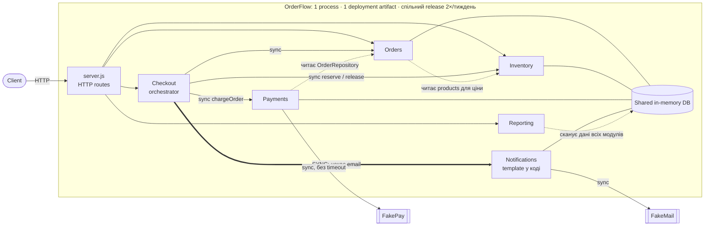
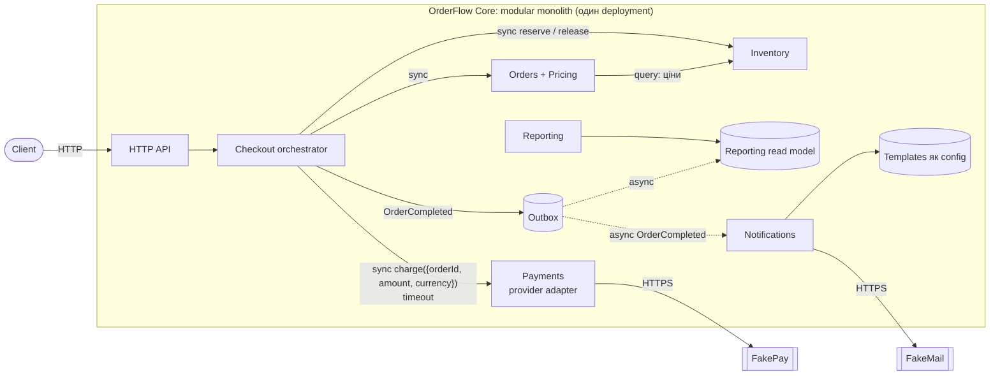

# OrderFlow: Architecture Analysis

## 1. Current architecture



### Responsibilities і dependencies

| Module | Responsibility | Залежить від | Оцінка залежності |
| --- | --- | --- | --- |
| Checkout | Координує checkout flow, при помилці повертає stock і позначає order як FAILED | Orders, Inventory, Payments, Notifications | Orders, Inventory, Payments: ✅ виправдано (потрібна consistency). Notifications: ❌ email у критичному шляху |
| Orders | Створює order, рахує total, змінює статуси | OrderRepository, таблиця products | ❌ бере ціни з даних Inventory через `shared/money.js` |
| Inventory | Резервує та повертає товар, захищає від повторних операцій | Власні таблиці | ✅ boundary коректний |
| Payments | Викликає payment provider і записує платіж | OrderRepository, FakePay | ❌ читав repository модуля Orders; ❌ провайдер без timeout |
| Notifications | Формує і синхронно відправляє email | FakeMail | ❌ template захардкожений у коді |
| Reporting | Sales summary та operational health | Колекції orders, payments, notifications, products | ❌ читає дані всіх модулів у тому самому process |

### Базові проблеми

1. **Payments читає Orders repository напряму.** Зміна моделі Order вимагає змін у Payments. 48% feature PR торкаються Orders і Payments одночасно.
2. **Checkout чекає email** (`CheckoutService.js`). Повільний або недоступний FakeMail затримує чи ламає checkout. Якщо email падає вже після оплати, order стає FAILED, хоча payment уже CAPTURED.
3. **Payment provider викликається без timeout.** Два останні інциденти почалися під час payment latency spikes.
4. **Reporting сканує operational data всіх модулів** у тому самому process, а traffic Reporting зростає.
5. **Один deployment і один release для всіх модулів.** Release Frequency впала з 5 до 2 на тиждень, Rollback Rate виріс з 2% до 9%.

---

## 2. Proposed architecture



Суцільна стрілка означає synchronous взаємодію, пунктирна означає asynchronous.

### Як змінюються dependencies

| Dependency | Було | Стало | Чому |
| --- | --- | --- | --- |
| Payments → Orders | Читає `OrderRepository` | Отримує `{orderId, amountCents, currency}` через contract | Payments не залежить від внутрішньої моделі Orders |
| Checkout → Notifications | Sync, checkout чекає email | Подія `OrderCompleted` через outbox | Email не впливає на успіх checkout |
| Notifications → template | Template у коді | Template як config | Зміна template не потребує deploy і regression checkout |
| Reporting → дані модулів | Сканує чужі колекції | Читає власний read model | Звіти не навантажують checkout і не ламаються від schema-змін інших модулів |
| Orders → products | Читає таблицю Inventory | Query API Inventory, Pricing всередині Orders | Pricing має одного власника |
| Payments → FakePay | Без timeout | Adapter з timeout | Повільний provider не блокує checkout безкінечно |
| Checkout → Orders, Inventory, Payments | Sync | **Без змін** (sync) | Потрібна strong consistency: reservation до оплати, повернення stock при помилці |

---

## 3. Decision summary

```text
Problem
  Проста зміна дедалі частіше зачіпає кілька modules і чекає спільний release.
  Checkout синхронно залежить від email і від payment provider без timeout.

Evidence
  Modules Changed per Feature 1,7 → 4,3; 48% PR зачіпають Orders і Payments;
  37% змін notification templates вимагали regression checkout; два останні
  інциденти почалися з payment latency; Rollback 2% → 9%; Lead Time 2 → 6 днів.

Decision
  Залишити modular monolith і покращити boundaries всередині нього:
  explicit contract між Payments і Orders, email через outbox (async),
  templates як config, Reporting на власному read model, timeout для payment provider.

Trade-offs
  + checkout не залежить від email, менше modules на одну зміну, менший scope тестування;
  − email і reports приходять із затримкою (до кількох хвилин),
    з'являються outbox і read model, які треба підтримувати.

How we will measure success
  Modules Changed per Feature 4,3 → < 2,5; Lead Time 6 → ≤ 3 дні;
  Rollback 9% → < 4%; зміни templates без regression checkout.
```

### Пріоритет architectural characteristics

| Пріоритет | Characteristic | Чому |
| --- | --- | --- |
| 1 | **Availability checkout** | Checkout прямо впливає на revenue; business ставить його вище за миттєвий email |
| 2 | **Data consistency** (Inventory, Payments) | Duplicate reservation спричиняє overselling, тож «гроші без замовлення» неприпустимі |
| 3 | **Modifiability** | Payments і Notifications змінюються найчастіше |
| 4 | **Deployability** | Спільний release створює чергу, rollback повертає весь release |
| 5 | **Scalability** Reporting | Traffic зростає, але дані з затримкою в кілька хвилин прийнятні |

**Чим поступаємося:** миттєвою доставкою email, повною свіжістю reports і незалежним deployment модулів (усі модулі залишаються в одному deployment).

### Зв'язок рішень з requirements і scenarios

| Scenario / requirement | Рішення | Як перевірити |
| --- | --- | --- |
| A: Marketing змінює templates 2–3 рази на тиждень | Templates як config, Notifications async | Зміна template без deploy і без regression checkout |
| B: другий payment provider | Payments працює через adapter і contract | Новий provider додається лише в Payments |
| C: Reporting traffic ×8–10 | Read model для Reporting | Checkout latency не зростає під навантаженням reports |
| D: Inventory idempotency | Inventory **не змінюється** | Повторний reserve не змінює stock двічі (існуючий тест) |
| E: payment provider відповідає 2–3 s | Timeout для provider, email поза checkout | Checkout має обмежений час відповіді; падіння email не ламає checkout |
| F: discount rules щомісяця | Pricing всередині Orders, Payments отримує суму через contract | Discount змінює Orders, а не 5–6 modules |
| Business: «повна зупинка delivery неприйнятна» | Поетапні зміни всередині monolith, без rewrite | Feature delivery продовжується паралельно |

---

## 4. Principles

| Principle | Де порушено зараз | Як змінює proposal |
| --- | --- | --- |
| **Information Hiding** | `PaymentService` читав `OrderRepository`; `ReportingService` знає структуру даних 4 модулів; `OrderService` читає таблицю products | Модулі взаємодіють через contract або подію, а не через чужі дані |
| **Explicit Contracts** | `chargeOrder(orderId)` змушував Payments самому шукати order | `chargeOrder({orderId, amountCents, currency})` і подія `OrderCompleted` |
| **Low Coupling** | `CheckoutService` синхронно чекає `NotificationService`, тож checkout залежить від FakeMail | Outbox прибирає залежність checkout від email |
| **High Cohesion** | Дотримано в `InventoryService`: уся логіка reserve/release та idempotency в одному місці | **Залишаємо без змін** |

---

## 5. Risk analysis

`Expected Risk Cost = Probability × Business Impact` (за місяць). Assumption: revenue checkout ≈ $3 000/год, Hourly Cost $50.

| Risk | Probability | Business Impact | Expected Risk Cost | Mitigation |
| --- | --- | --- | --- | --- |
| Payment latency spike блокує checkout | 0,8 | ≈ $3 000 (≈ 1,5 год інциденту, втрачені замовлення, recovery) | ≈ $2 400 | Timeout для provider, моніторинг latency |
| Email падає після оплати: order FAILED, payment CAPTURED | 0,9 | ≈ $4 000 (refund, support, ризик overselling) | ≈ $3 600 | Email через outbox поза критичним шляхом |
| Outbox зупиняється, email затримуються | 0,3 | ≈ $700 (звернення клієнтів, ручна повторна відправка) | ≈ $210 | Alert на затримку outbox, повторна відправка |

---

## 6. Metrics та Fitness Function

| Metric | Зараз → Target | Чому важлива |
| --- | --- | --- |
| Modules Changed per Feature | 4,3 → < 2,5 | Показує, чи зменшився coupling між модулями |
| Change Lead Time | 6 → ≤ 3 дні | Показує швидкість доставки змін |
| Rollback Rate | 9% → < 4% | Показує, чи зменшився ризик кожного release |
| Template changes з regression checkout | 37% → 0% | Показує, чи відокремлено Notifications від checkout |

**Fitness Functions** (`tests/architecture.test.js`, `npm test`):

```text
Payments не імпортує orders/ і не використовує OrderRepository.
Зміна notification template не потребує змін в Orders, Payments, Inventory.
```
